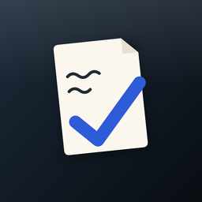
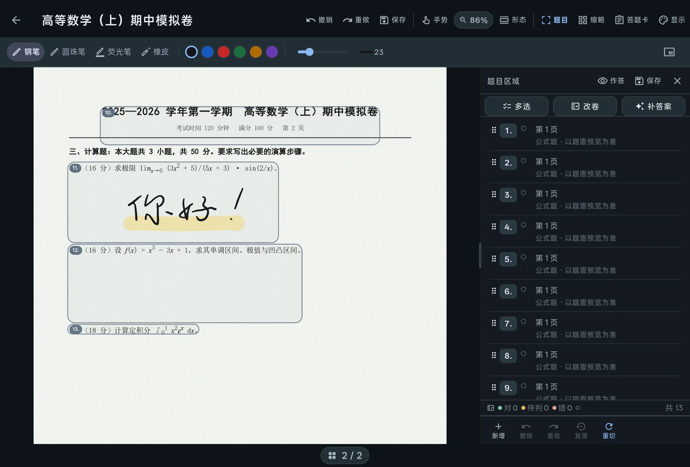

<p align="center">
  
</p>

<h1 align="center">刷起 SHUAQI</h1>

<p align="center"><b>把你的 PDF 卷子，变成能判分、能二刷的题本。</b></p>

<p align="center">
  <a href="https://github.com/Terryliu001/SHUA_QI/releases">下载</a> ·
  <a href="https://terryliu001.github.io/SHUA_QI/">展示页</a> ·
  <a href="项目日志/README.md">开发日志</a> ·
  <a href="宣传/075-功能清单与宣发建议.md">功能清单</a>
</p>



Android 平板上的刷题工具：**导入你自己的 PDF 试卷**，用手写笔在卷面上作答，
它会自动把页面切成一道道题，判出对错，再把错题组成新卷子用空白答题卡重刷一遍。

不需要账号，不需要联网（AI 除外），不传任何卷子。

---

## 下载

| 项 | 值 |
|---|---|
| 版本 | v0.1.1（内测） |
| 平台 | Android 8.0+ · **仅 arm64** · 平板 + 手写笔最佳 |
| 体积 | 36.7 MB（已用 release 密钥签名） |
| 位置 | [Releases](https://github.com/Terryliu001/SHUA_QI/releases) → `shuaqi-0.1.1.apk` |

> 装过更早的 debug 签名版本时，两个包签名不同、需要先卸载（卸载会删本机数据，先导出备份）。

## 它和别的刷题工具不一样的地方

1. **在真卷子上写**：底图是原 PDF，笔迹是独立图层；橡皮是切开笔画的局部擦除。
2. **卷子会被切成一道一道题**：文本层 / 扫描件两套切题，切歪了能手调、能锁定。
3. **判题先本地**：选择题、数值题离线就判，判不了才标黄点问 AI；手改永远优先。
4. **错题长成第二本卷子**：收藏是跨卷快照 → 知识点 → 组卷 → 空白答题卡重刷。
5. **数据是自己的**：全本机、无账号、一键 zip 备份；AI 用你自己的 Key。

完整功能与边界（包括现在**没有**交卷总分页、公式题只给图）见
[075 功能清单](宣传/075-功能清单与宣发建议.md) 与 [展示页 FAQ](Rpage/index.html)。

## 仓库结构

| 目录 | 内容 |
|---|---|
| `main/` | Flutter 应用（`lib/` 分层：ui → state → domain → infra） |
| `Rpage/` | 展示与下载页（零构建静态站，GitHub Pages 从这里发） |
| `项目日志/` | 40 篇开发日志（现象 → 根因 → 修法 → 证据） |
| `宣传/` | 对外材料：功能清单、Release 正文稿 |
| `server/feedback-worker/` | 应用内反馈的 Cloudflare Worker（可选部署） |

## 构建

```bash
cd main
flutter pub get
# release（含反馈通道凭证，凭证从 _verify/.gh_app_token 读，不进 git）
powershell -File tool/build_release.ps1
# 产物 build/app/outputs/flutter-apk/app-arm64-v8a-release.apk
```

版本锁定：Flutter 3.47.6 / Dart 3.13.5；依赖全部钉死（见 `main/pubspec.yaml`）。
测试：`powershell -File tool/run_tests.ps1`（宿主机会临时摘掉 pdfrx，见日志 071）。

## 已知限制（诚实清单）

- **没有**「交卷 → 总分 / 成绩报告」页
- 公式题目前只给图，不做公式识别
- 手写识别首次使用需联网下载模型
- 用户反馈已接通（写入开发者的私有反馈仓库），但**没有回复通知**：开发者回复后不会在 App 内推送
- 只有 Android / arm64；没有 iOS、桌面版、多设备同步
- 界面按平板横屏设计，手机竖屏能用但很挤

## 数据与隐私

无账号、无云同步、无埋点；卷子、笔迹、判题结果都在应用私有目录。
AI 是可选项：填你自己的 OpenAI 兼容端点与 Key，请求直接发往你填的地址，本项目不做中转。
用户反馈只在你点「提交」时发送（文字 + 最多 3 张截图 + 版本/设备型号），手机号选填且只进私有 issue。

## 许可

本仓库暂未附开源许可证（保留所有权利）。如需引用、二次分发或商用，请先开 Issue 联系作者。
